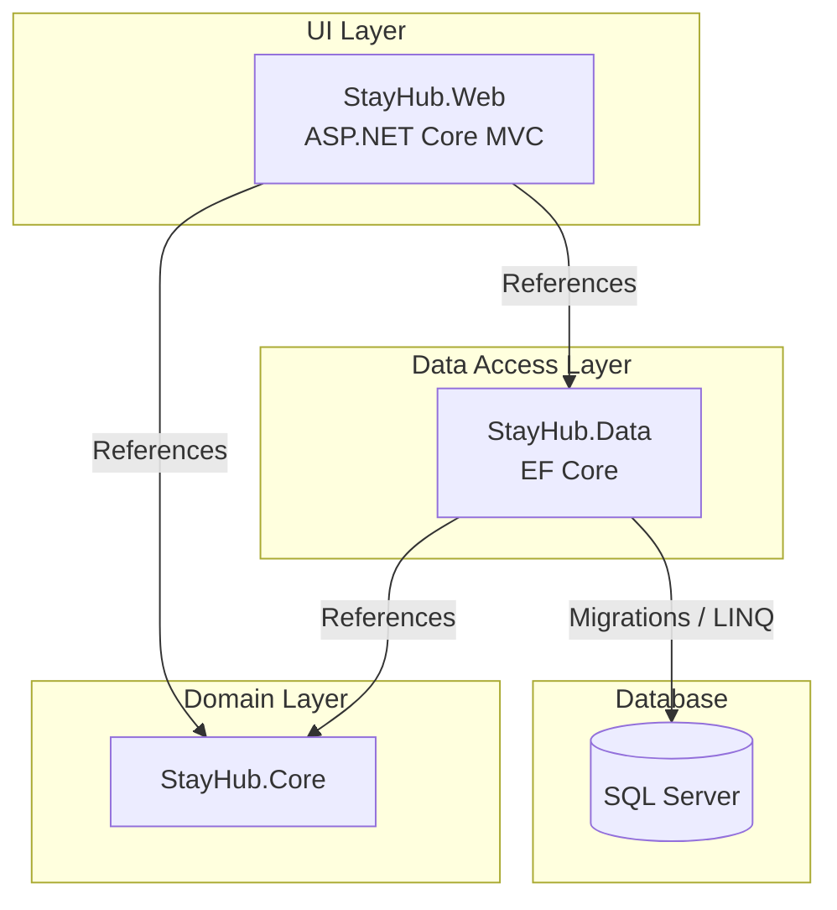
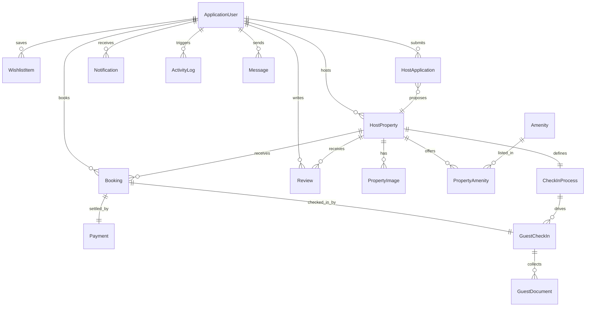

# StayHub Architecture and Design

This document outlines the system architecture, database design, and the application of Object-Oriented Programming (OOP) principles within the StayHub project.

## 1. System Architecture

StayHub is built using a 3-tier architecture to separate concerns, improve maintainability, and demonstrate enterprise-level design patterns. The solution is divided into three distinct .NET projects:



### Project Breakdown

1. **`StayHub.Core` (Domain Layer):** Domain models (`HostProperty`, `Booking`, `HostApplication`), enums, role constants, and repository interfaces. Its only external dependency is `Microsoft.Extensions.Identity.Stores`, so `ApplicationUser` can extend `IdentityUser` without dragging the database or the web host into the domain.
2. **`StayHub.Data` (Data Access Layer):** `StayHubDbContext` (an `IdentityDbContext<ApplicationUser>`), one `IEntityTypeConfiguration` per aggregate, EF Core migrations, the repository implementations, and the startup seeders.
3. **`StayHub.Web` (UI Layer):** Controllers, Razor views, view models, the "Cape Aegean" stylesheet, file-upload and role-transition services, and the DI/pipeline wiring in `Program.cs`.

The dependency arrows only ever point inwards. `StayHub.Core` knows nothing about EF Core or MVC, which is what makes the repository interfaces meaningful rather than decorative.

### Difference from the SkyFlow sibling project

StayHub deliberately mirrors SkyFlow's repository layout - `src/`, `sql/`, `docs/`, the same `.github` templates, the same XML-documented layered projects - with two substitutions the brief requires:

| Concern       | SkyFlow                       | StayHub                                    |
| ------------- | ----------------------------- | ------------------------------------------ |
| UI layer      | `SkyFlow.Console` (terminal)  | `StayHub.Web` (ASP.NET Core MVC, browser)  |
| Data access   | Dapper + hand-written SQL     | EF Core + migrations                       |
| Schema source | `sql/002-create-tables.sql`   | `src/StayHub.Data/Migrations/`             |
| Auth          | BCrypt against a `Users` table | ASP.NET Core Identity with four roles     |

Because EF Core migrations own the schema, `sql/` holds only database creation, teardown, and verification scripts rather than table definitions. Seeding is programmatic (`RoleSeeder`, `DataSeeder`), which the brief permits.

### Infrastructure & Deployment

To keep the environment consistent between Windows and macOS (including Apple Silicon), SQL Server runs in Docker.

- **Container 1 (`stayhub-sql`):** Microsoft SQL Server 2022, pinned to `platform: linux/amd64` so it runs under Rosetta on ARM Macs.
- **Container 2 (`sql-setup`):** A transient service that waits for the server to accept connections and runs `sql/001-create-database.sql`. Everything after that - tables, indexes, constraints, seed rows - is applied by `context.Database.MigrateAsync()` on the first application start.

---

## 2. Database Entity-Relationship Diagram



### Cascade behaviour

SQL Server rejects multiple cascade paths converging on one table. Because `AspNetUsers` is the parent of properties, bookings, reviews, and both sides of a message, several foreign keys are configured `DeleteBehavior.Restrict`:

| Relationship                   | Behaviour | Reason                                                  |
| ------------------------------ | --------- | ------------------------------------------------------- |
| `HostProperty.HostId`          | Restrict  | Avoids a second cascade path into `AspNetUsers`         |
| `Booking.GuestId`              | Restrict  | Same; a guest's history should survive listing changes  |
| `Message.SenderId` / `.ReceiverId` | Restrict | One user appears on both sides of the relationship  |
| `PropertyImage.PropertyId`     | Cascade   | Images are meaningless without their listing            |
| `Booking.Payment` / `.GuestCheckIn` | Cascade | Both are owned wholly by the booking                 |

---

## 3. Object-Oriented Programming Pillar Mapping

### 1. Encapsulation

`Booking` keeps its status in a private `_status` field. The only way business code changes it is through `Approve()`, `Reject()`, `MarkPaid()`, `CheckIn()`, `Complete()`, and `Cancel()` - each of which returns `false` rather than performing an invalid transition. A rejected booking therefore cannot silently become approved.

`HostProperty` does the same for `_isActive` via `Activate()` / `Deactivate()`, and owns its pricing arithmetic in `CalculateTotalPrice(int nights)` so the formula `(PricePerNight × Nights) + CleaningFee + ServiceFee` exists in exactly one place.

### 2. Inheritance

`ApplicationUser : IdentityUser` extends the framework's identity type with the profile fields the brief specifies (`FirstName`, `LastName`, `ProfilePictureUrl`, `CreatedAt`), inheriting credential storage, lockout, and claims for free.

`StayHubDbContext : IdentityDbContext<ApplicationUser>` inherits the entire Identity schema and layers the fifteen domain tables on top.

`EditPropertyViewModel : HostApplicationViewModel` reuses the application form's fields and validation, adding only the identifier, activation flag, and existing images.

### 3. Polymorphism

Every repository is consumed through its interface. `HostController` depends on `IPropertyRepository`, never on `PropertyRepository`; the concrete EF Core type is substituted by the DI container in `Program.cs`. Swapping the data layer for Dapper - the way SkyFlow does it - would need no controller changes.

`BookingRequestViewModel` implements `IValidatableObject`, so MVC's validation pipeline calls its `Validate` override polymorphically alongside the attribute-based rules.

### 4. Abstraction

`IRoleTransitionService` hides the multi-step Guest-to-Host swap (add role, remove role, write the audit entry) behind one call, so both the approval path and any future path perform it identically. `IFileStorageService` hides where uploads physically live; the controllers only ever see the returned relative URL.

---

## 4. Request Lifecycle

A representative flow - an administrator approving a host application:

```
POST /Admin/ApproveApplication
  └─ [Authorize(Roles = "Admin,SuperAdmin")]  ← rejected here if the role is wrong
  └─ AdminController.DecideApplicationAsync
       ├─ IHostApplicationRepository.UpdateAsync   → Status = Approved
       ├─ IRoleTransitionService.PromoteGuestToHostAsync
       │    ├─ UserManager.AddToRoleAsync(Host)
       │    ├─ UserManager.RemoveFromRoleAsync(Guest)
       │    └─ IActivityLogRepository.LogAsync(RoleChange)
       ├─ IPropertyRepository.UpdateAsync          → property.Activate()
       ├─ IActivityLogRepository.LogAsync(ApplicationReviewed)
       └─ INotificationRepository.CreateAsync("Host Application Approved")
```

Every mutating action follows the same shape: authorise, mutate through a repository, write an activity log entry, then notify the affected user.

---

## 5. Visual Design System - "Cape Aegean"

The interface uses an original identity rather than borrowing an existing platform's look. The reference point is the Greek-styled Cape West Coast resort architecture at Langebaan: whitewashed walls, deep blue domes and shutters, hard sunlight, and terracotta detailing.

### Palette

Every colour is declared once as a custom property in `wwwroot/css/stayhub.css`, so the theme can be retuned from a single block.

| Token                 | Value     | Role                                        |
| --------------------- | --------- | ------------------------------------------- |
| `--sh-primary`        | `#0e6ba8` | Aegean blue - all primary actions, brand    |
| `--sh-primary-dark`   | `#0a527f` | Hover and pressed states                    |
| `--sh-primary-soft`   | `#e7f1f8` | Tinted surfaces, selected rows              |
| `--sh-sun`            | `#f6b31b` | Sun-yellow - counts, badges, highlights     |
| `--sh-terracotta`     | `#c75b39` | Warm accent, used sparingly                 |
| `--sh-ink`            | `#16323f` | Deep harbour navy, used instead of black    |
| `--sh-muted`          | `#5f7683` | Secondary text                              |
| `--sh-shade`          | `#f2f7fa` | Whitewash background                        |

### Contrast decisions

- White on `--sh-primary` measures **5.7:1**, clearing WCAG AA for normal text, so the same blue serves both button fills and body links.
- Notification counts render as **ink on sun-yellow (7.3:1)** rather than white on a mid-tone fill. At `0.65rem` the badge text is the smallest type in the interface, so it was given the highest contrast pairing available in the palette.
- The header keyline blends blue → terracotta → sun. Interpolating blue straight to yellow in sRGB passes through a muddy green; routing through terracotta keeps the sweep warm.

### Logo mark

`wwwroot/images/brand/stayhub-mark.svg` is an open arch - a Cycladic doorway - with the sun showing through it. It is drawn as a stroked path rather than a filled silhouette: an earlier filled version with a punched-out doorway read as a lowercase "n" at header size. The favicon inverts the same geometry in white on blue.

### Typography

The system font stack is used deliberately (`-apple-system`, `Segoe UI`, `Roboto`, …). It carries no licensing burden, needs no network request, and renders natively on the Windows and macOS machines this project is marked on.

---

## 6. Security Notes

- Passwords are handled entirely by ASP.NET Core Identity (PBKDF2 with per-user salts); no credential is ever stored or compared by application code.
- Every state-changing action is a `POST` guarded by `[ValidateAntiForgeryToken]`.
- Route protection uses `[Authorize(Roles = ...)]` with the constants in `StayHub.Core.Constants.Roles`, so a typo in a role name is a compile error rather than a silent security hole.
- Ownership is re-checked in the data layer, not only in the URL: `ToggleActiveAsync(id, hostId)` and `MarkAsReadAsync(id, userId)` both filter by the acting user, so guessing another user's identifier changes nothing.
- Uploads are restricted by extension and size, and are stored under a generated GUID filename rather than the user-supplied one.
